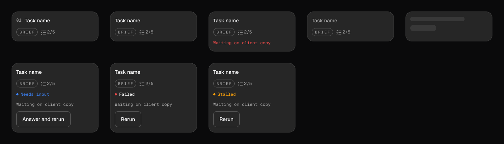
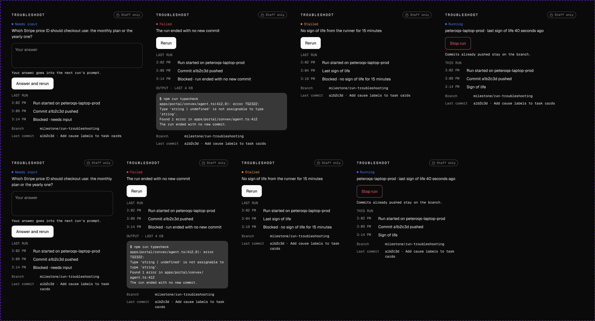
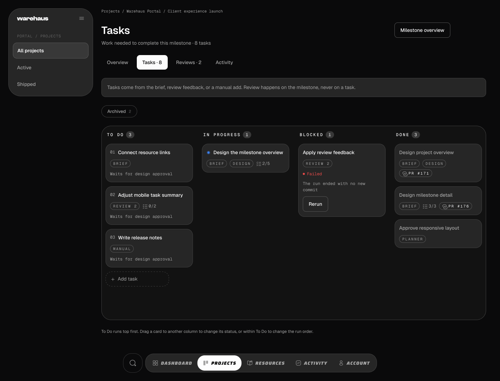
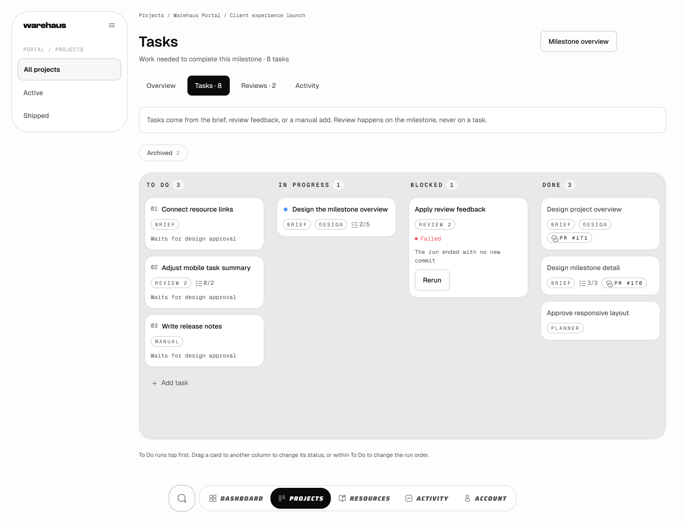
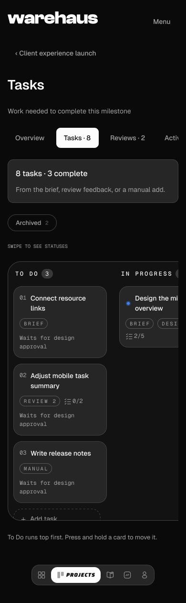
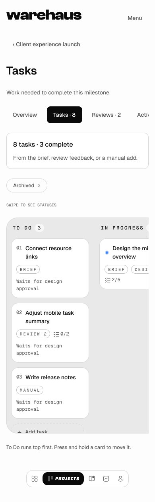
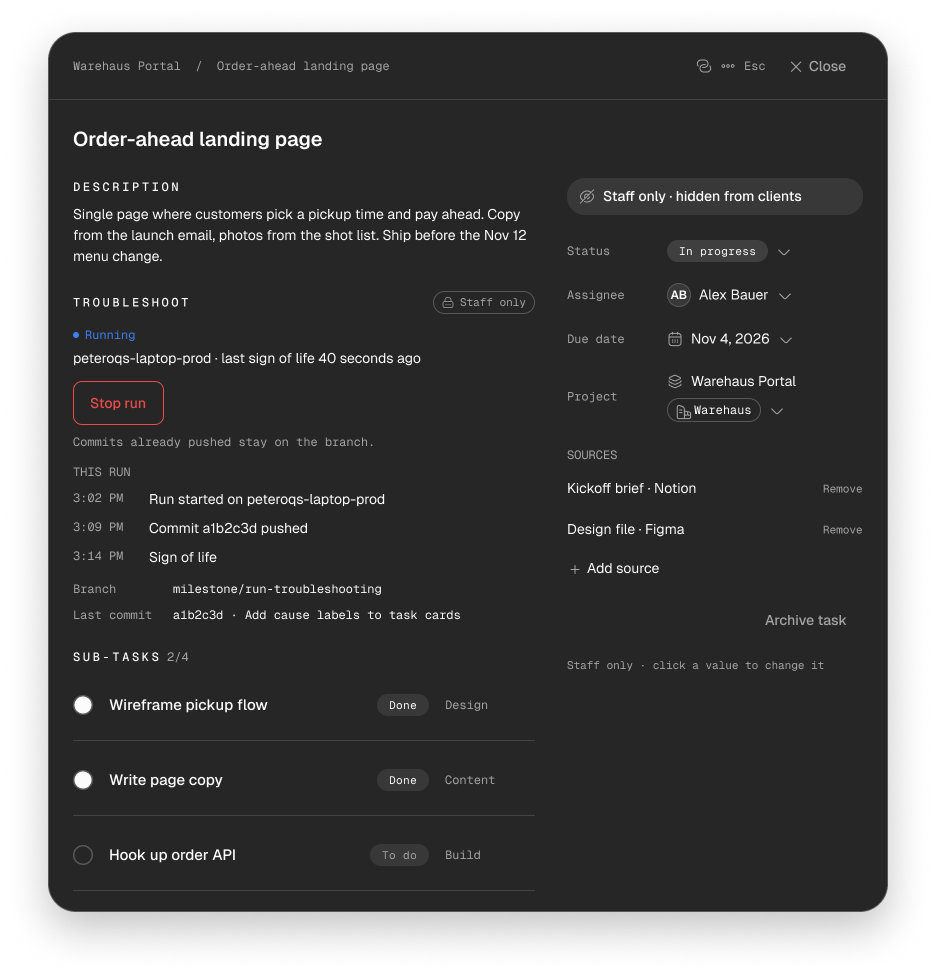
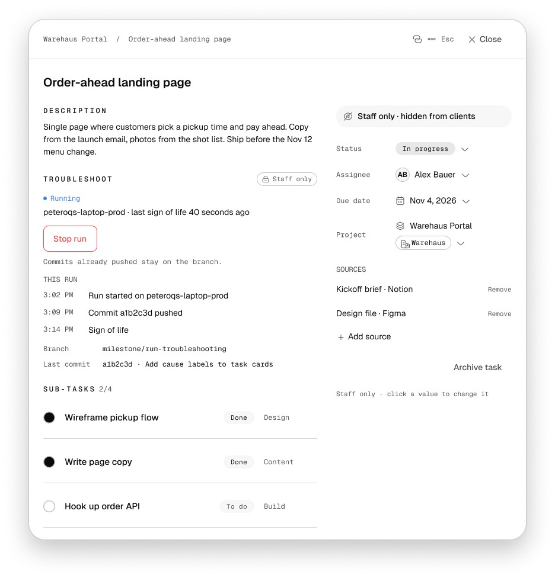
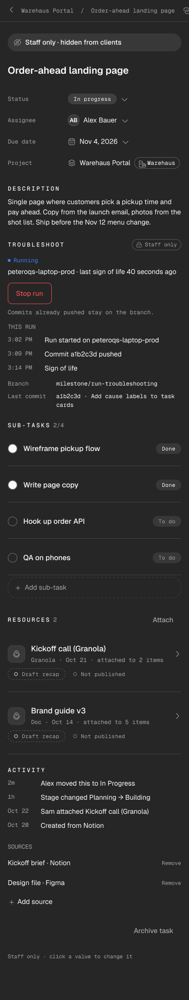
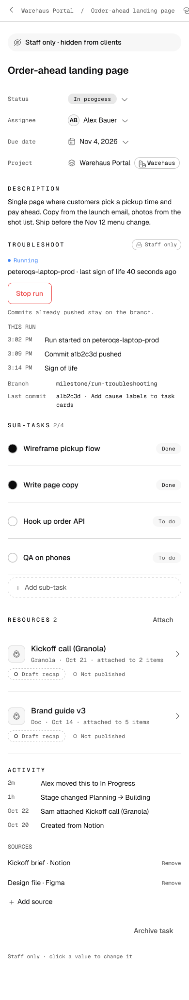

# Run troubleshooting: design

Design for the Portal milestone "Run troubleshooting" (decisions 0012 to 0014), task 01. Drawn in [Warehaus Studio](https://www.figma.com/design/TS3DcaCgrIdYf0jhvnMy3k/Warehaus-Studio) on 2026-11-28 under `docs/design/figma-protocol.md`. Nothing was moved or archived, so `figma-id-map.md` has no new rows. The library is not published.

Build tasks copy the strings below character for character.

## What changed in Figma

| What | Node | Where |
|---|---|---|
| `Organism/Card/Milestone task`: new `Cause` property and `Show fix` boolean | [`1106:8680`](https://www.figma.com/design/TS3DcaCgrIdYf0jhvnMy3k/Warehaus-Studio?node-id=1106-8680) | Component Library / Organisms |
| `Organism/Troubleshoot` (new set, 8 variants) | [`1352:9984`](https://www.figma.com/design/TS3DcaCgrIdYf0jhvnMy3k/Warehaus-Studio?node-id=1352-9984) | Component Library / Organisms |
| `Organism/TaskDetailModal`: `Show troubleshoot` boolean on the staff variants | [`759:11790`](https://www.figma.com/design/TS3DcaCgrIdYf0jhvnMy3k/Warehaus-Studio?node-id=759-11790) | Component Library / Organisms |
| `Organism/ConfirmFrame` and `Organism/ConfirmFrame/Body`: `Kind=stop-run` | `1348:32179` (center), `1348:32230` (bottom) | Component Library / Organisms |
| Canonical screen: the Blocked card shows a Failed cause | [`1166:14923`](https://www.figma.com/design/TS3DcaCgrIdYf0jhvnMy3k/Warehaus-Studio?node-id=1166-14923) (1440 Dark), `1166:15125` (390 Dark) | Projects / P04 · Milestone tasks board, SCREEN |
| Task modal overlay shows the Troubleshoot section | `1166:15975` (1440 Dark), `1166:16222` (390 Dark) | P04, OVERLAYS |
| Stop run confirm overlays (new) | `1352:49693` (1440 Dark), `1352:49747` (390 Dark), Light instances `1352:49720`, `1352:49776` | P04, OVERLAYS |

Light frames are instances on the Light mode and follow the Dark components.

## Blocked cause on the task card

`Cause` applies to `Status=Blocked` only. Staff only.

| `Cause` | Label | Label colour | Fix button |
|---|---|---|---|
| `none` | no label; the Waiting on text in `--danger`, as today | | none |
| `needs-input` | Needs input | `--info` | Answer and rerun |
| `failed` | Failed | `--danger` | Rerun |
| `stalled` | Stalled | `--warning` | Rerun |

- The label is a 6 px dot and the cause name in Geist Mono 12, above the reason.
- The reason is the existing Waiting on text, in `--muted` when a cause is set.
- The fix is one Secondary button under the reason. `Show fix` hides it.
- Answer and rerun on the card opens the task modal at the Troubleshoot section, where the answer is typed. Rerun on the card reruns at once.
- Clients get `Cause=none` with Show waiting off: no cause, no reason, no fix.

## Troubleshoot section in the task modal

`Organism/Troubleshoot`, `State` × `Size`. It sits under Description in the staff variants of the task modal: the main column at 1440 (462 wide), the sheet at 390 (358 wide). Client variants never carry it. `Show troubleshoot` is on when the task is Blocked with a runner cause or has a run going.

Top to bottom:

1. Header: TROUBLESHOOT, with the Staff only tag on the right.
2. Cause label (as on the card) and the reason in Geist 14.
3. The fix (table below).
4. LAST RUN (THIS RUN while running): the run's events, time then text.
5. OUTPUT · LAST 4 KB: `failed` only. Mono text in a `--surface-2` box.
6. Branch and Last commit rows, values in Geist Mono.

| `State` | Cause label | Fix | Extra copy |
|---|---|---|---|
| `needs-input` | Needs input | Answer field (placeholder "Your answer"), then Primary button Answer and rerun | Hint under the field: "Your answer goes into the next run's prompt." |
| `failed` | Failed | Primary button Rerun | |
| `stalled` | Stalled | Primary button Rerun | |
| `running` | Running (`--info`) | Danger button Stop run | Hint under the button: "Commits already pushed stay on the branch." The reason line reads "<runner> · last sign of life <time> ago". |

- Stop run shows only on a protocol 3 runner. On an older runner the button and its hint are hidden.
- Rerun never shows on a Done task.
- Out of scope, so not drawn: planning runs, Cursor builds, full logs, live output.

Sample event text in the frames: "Run started on peteroqs-laptop-prod", "Commit a1b2c3d pushed", "Sign of life", "Last sign of life", "Blocked · needs input", "Blocked · run ended with no new commit", "Blocked · no sign of life for 15 minutes".

## Stop run confirm

`Organism/ConfirmFrame`, `Kind=stop-run`. Center at 1440, bottom sheet at 390. Focus starts on Cancel, as on every confirm.

- Title: "Stop this run?"
- Body: "The runner stops working on this task. Commits it already pushed stay on the branch, and a late result is ignored."
- Buttons: Cancel (Secondary), Stop run (Danger).

## Screens

| | Dark | Light |
|---|---|---|
| Board 1440 |  |  |
| Board 390 |  |  |
| Task modal 1440 |  |  |
| Task modal 390 |  |  |

## Not drawn in this task

- The Blocked Ask in the Attention feed. The milestone has it show the cause and open the task; task 01's brief did not include it, so the feed row has no cause label in Figma yet. Task 05 built it without a frame: the alert carries the cause, and the Mac notification body leads with the cause label from the card and names the fix ("Needs input. Open the task to answer and rerun.", "Failed. Open the task to see why and rerun.", "Stalled. Open the task to see why and rerun."). The title stays "Needs you: <milestone>". The wording needs a frame or Peter's OK.
- The Stop run confirm was already in the library from an earlier run of this task (`Kind=stop-run`). This task added its overlay frames on P04 and the changelog lines.
